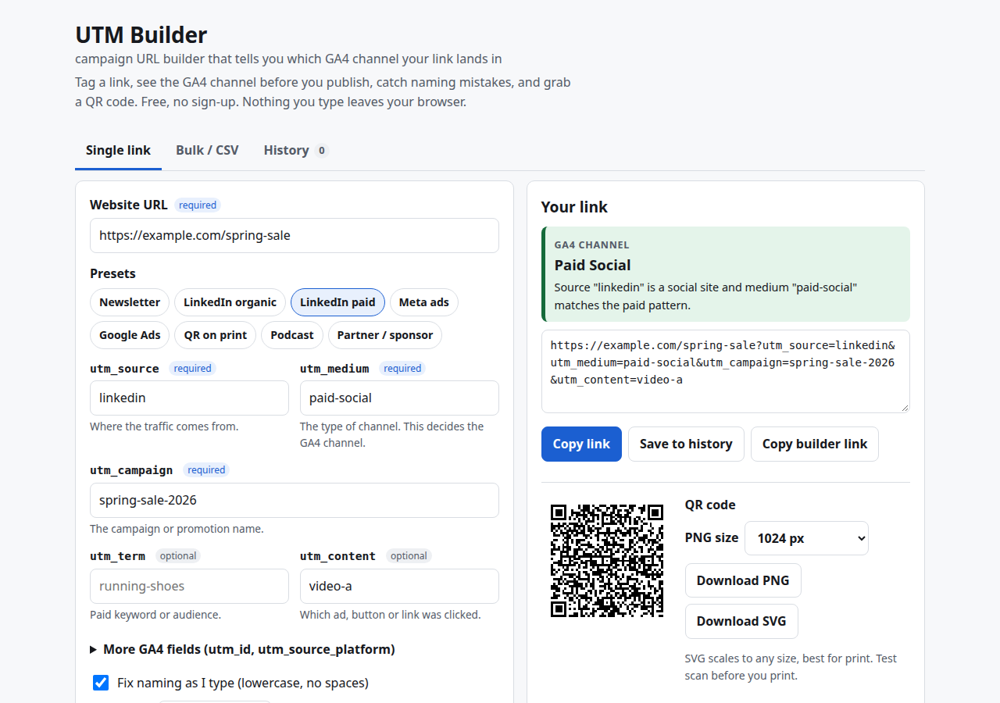

# UTM Builder

**Live:** https://mizoz.github.io/utm-builder/

A UTM link builder that tells you which GA4 channel your link will land in, before you post it.



I built this because I kept finding campaign traffic sitting in "Unassigned" in GA4. Someone used `utm_medium=newsletter`, someone else used `Email`, the QR code on the poster said `qr`. Google's own Campaign URL Builder happily builds all of those. This one checks your values against the GA4 default channel group rules as you type and tells you what's going to happen.

## What it does

- Builds the link with utm_source, utm_medium, utm_campaign, utm_term, utm_content, plus utm_id and utm_source_platform
- Shows the GA4 default channel the link lands in (Paid Social, Email, Referral, Unassigned...) and which rule matched
- Warns about spaces, capital letters, missing required fields, swapped source/medium, "paid" mediums GA4 won't treat as paid, campaign names with "shop" in them (they get pulled into Shopping channels, fun one), and spellings that don't match links you saved before
- Fixes naming as you type: lowercase, hyphens or underscores, ad platform macros like `{{ad.name}}` and `{keyword}` left alone
- Presets: newsletter, LinkedIn organic, LinkedIn paid, Meta ads, Google Ads, QR on print, podcast, partner/sponsor
- Bulk mode: paste a list of URLs or a CSV, export a CSV with the tagged links, channel and warnings
- History saved in your browser, with filter, reload, copy and CSV export
- QR code for every link, PNG (up to 2048 px) or SVG
- The whole form state lives in the page URL, so you can send a teammate a pre-filled builder

## Privacy

Everything runs in your browser. No server, no analytics, no cookies. History is in localStorage on your device. The only outside request is the QR code library from cdnjs (pinned with SRI).

## How it works

Plain HTML, CSS and JS. No build step. The channel logic is a straight copy of the GA4 default channel group conditions for manually tagged traffic, checked in the same order GA4 uses. GA4 also matches source against Google's big lists of search, social, video and shopping sites. I included the common ones, not the whole spreadsheet, so an obscure source may show as "Paid Other" here and something more specific in GA4.

QR codes use [qrcode-generator](https://github.com/kazuhikoarase/qrcode-generator) by Kazuhiko Arase (MIT).

## Run locally

```
git clone https://github.com/mizoz/utm-builder
cd utm-builder
python3 -m http.server
```

Then open http://localhost:8000.

## Sources

Last checked 2026-10-21.

- GA4 default channel group rules: https://support.google.com/analytics/answer/9756891
- GA4 URL parameters (utm_id, utm_source_platform, utm_creative_format, utm_marketing_tactic): https://support.google.com/analytics/answer/10917952
- Meta dynamic URL parameters (`{{campaign.name}}`, `{{adset.name}}`, `{{ad.name}}`): https://www.facebook.com/business/help/2360940870872492
- Google Ads ValueTrack parameters (`{keyword}`, `{creative}`, `{campaignid}`): https://support.google.com/google-ads/answer/6305348

## More tools I made

- [Social Image Sizer](https://mizoz.github.io/social-image-sizer/)
- [Post Preview](https://mizoz.github.io/post-preview/)
- [Sponsorship Builder](https://mizoz.github.io/sponsorship-builder/)
- [Stream Calc](https://mizoz.github.io/stream-calc/)

## License

MIT. See [LICENSE](LICENSE).

Made by [Ahmed Mahmoud](https://mizoz.github.io/) in Calgary.
